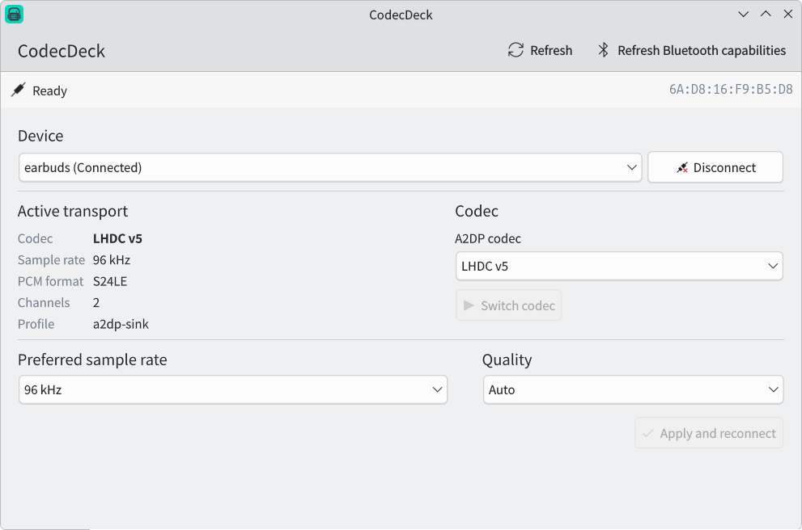

# CodecDeck

[](https://github.com/mizuikki/codecdeck/actions/workflows/ci.yml)
[](https://github.com/mizuikki/codecdeck/releases/latest)
[](LICENSE)

CodecDeck is a Linux desktop control panel for Bluetooth audio codecs on
PipeWire and WirePlumber. It shows the negotiated audio transport, switches
A2DP codecs, and manages LDAC and LHDC v5 quality preferences from one place.



## Install

Download the Debian package from the
[latest GitHub Release](https://github.com/mizuikki/codecdeck/releases/latest),
then install it with APT:

```sh
sudo apt install ./codecdeck_*_amd64.deb
```

Release packages currently target Ubuntu 26.04 on amd64. The package includes
the desktop application, privileged helper, Polkit policy, desktop entry,
AppStream metadata, and application icons.

## Usage

1. Pair a Bluetooth audio device in the system settings.
2. Open CodecDeck and select the device.
3. Connect the device if necessary, then select an available A2DP codec.
4. Use **Switch codec** for a temporary profile change.
5. Choose a preferred sample rate and quality mode, then use
   **Apply and reconnect** to persist the settings through WirePlumber.

Live codec and format controls become available after BlueZ reports the device
as connected and PipeWire publishes its A2DP transport. Use **Refresh Bluetooth
capabilities** only when BlueZ is exposing stale codec capabilities; this action
requires Polkit authorization and briefly disconnects the selected device.

## Features

- Native PipeWire device and node discovery without parsing command output
- Paired A2DP device discovery and connection control through BlueZ
- Active codec, profile, PCM format, sample rate, and channel count
- Requested-versus-negotiated codec and sample-rate fallback indicators
- Codec switching through PipeWire device profile parameters
- LDAC quality modes: Auto, High, Standard, and Mobile
- LHDC v5 quality modes: Auto, 400, 500, 900, and 1000 kbit/s
- Persistent preferred sample rate and quality settings
- Atomic WirePlumber configuration updates and managed reconnection
- Polkit-authorized refresh of stale BlueZ codec capabilities

## Compatibility

- Qt 6.8 or newer with Qt Quick Controls and KDE Kirigami
- PipeWire 1.4 or newer
- WirePlumber 0.5 or newer
- BlueZ 5
- A PipeWire build with the desired Bluetooth codec libraries enabled

Available codecs depend on the local PipeWire build and the capabilities of the
Bluetooth device. CodecDeck displays the negotiated PCM bit depth but does not
offer a bit-depth selector because PipeWire does not expose a stable per-codec
setting for it.

## Build from source

Install the development dependencies on Ubuntu:

```sh
sudo apt install cmake ninja-build g++ pkg-config extra-cmake-modules \
  qt6-base-dev qt6-declarative-dev qt6-declarative-dev-tools \
  qml6-module-org-kde-kirigami qml6-module-qtquick \
  qml6-module-qtquick-controls qml6-module-qtquick-layouts \
  libpipewire-0.3-dev
```

Configure, build, test, and run CodecDeck:

```sh
cmake -S . -B build -G Ninja \
  -DCMAKE_BUILD_TYPE=RelWithDebInfo \
  -DCMAKE_INSTALL_PREFIX=/usr
cmake --build build
ctest --test-dir build --output-on-failure
./build/codecdeck
```

To install the application for the current user and the narrowly scoped helper
system-wide:

```sh
cmake --install build --prefix "$HOME/.local" --component Application
sudo cmake --install build --prefix /usr --component PrivilegedHelper
```

The application remains usable without the helper, but it cannot refresh stale
BlueZ capability caches.

## Build a Debian package

```sh
cmake -S . -B build-release -G Ninja \
  -DCMAKE_BUILD_TYPE=Release \
  -DCMAKE_INSTALL_PREFIX=/usr
cmake --build build-release
ctest --test-dir build-release --output-on-failure
cpack --config build-release/CPackConfig.cmake -B dist
```

Pushing a version tag such as `v0.1.1` runs the release workflow, validates the
tag against the CMake project version, and publishes the Debian package, source
archive, and SHA256 checksums.

## Configuration and permissions

CodecDeck writes one user-owned WirePlumber drop-in:

```text
~/.config/wireplumber/wireplumber.conf.d/51-codecdeck.conf
```

Applying settings restarts the current user's `wireplumber.service`, briefly
interrupting Bluetooth audio while the transport reconnects. Normal device
connection, disconnection, codec switching, and configuration do not require
root privileges.

**Refresh Bluetooth capabilities** is the only privileged operation. Polkit
runs `/usr/libexec/codecdeck-helper`, which validates the selected BlueZ object
path, backs up the exact cache file under `/var/backups/codecdeck`, and removes
only that file. The GUI always remains unprivileged.

## Development

- [Architecture and runtime data flow](docs/architecture.md)
- [Application icon assets](docs/branding.md)
- [Issue tracker](https://github.com/mizuikki/codecdeck/issues)

Contributions are welcome. Before opening a pull request, build the project and
run `ctest --test-dir build --output-on-failure`.

## License

CodecDeck is available under the [MIT License](LICENSE).
